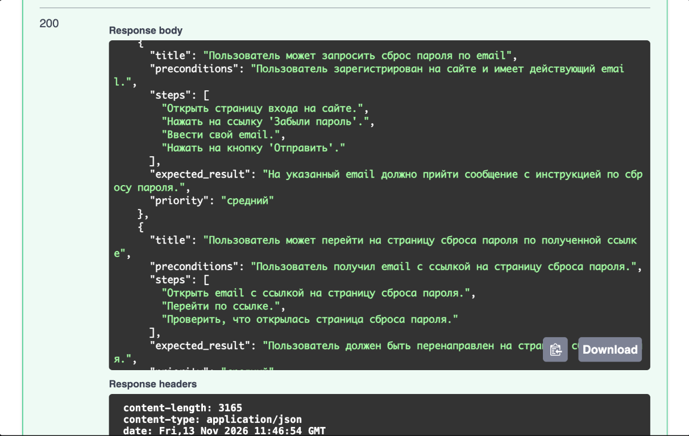

# qa-copilot

API-ассистент для QA-инженера. Принимает текст требования и генерирует тест-кейсы на русском языке в структурированном формате JSON. Это первый прототип сквозного проекта курса AI Engineer (Neoflex).

## Возможности

- генерация тест-кейсов по тексту требования;
- структурированный JSON-ответ с проверкой полей;
- настройка температуры и максимального количества тест-кейсов;
- подключение любой языковой модели с OpenAI-совместимым API;
- русскоязычная документация API в Swagger.

## Требования

- Python 3.10 или новее;
- языковая модель с OpenAI-совместимым API.

Для локального запуска можно использовать [Ollama](https://ollama.com/). Установите Ollama и скачайте модель:

```bash
ollama pull qwen2.5:7b
```

## Установка и запуск

Откройте терминал в папке проекта и выполните:

```bash
python3 -m venv .venv
source .venv/bin/activate
pip install -r requirements.txt
```

Настройки нужно задать в том же терминале, из которого запускается сервер. Пример для локального Ollama:

```bash
export LLM_BASE_URL=http://localhost:11434/v1
export LLM_API_KEY=ollama
export LLM_MODEL=qwen2.5:7b
uvicorn app.main:app --reload
```

Для другого провайдера укажите его адрес, API-ключ и название модели. Не добавляйте реальные ключи в файлы проекта или Git.

## Проверка

Откройте документацию API: <http://localhost:8000/docs>

Пример успешного ответа `/generate-testcases`:



1. Выполните `GET /health`. Ожидаемый ответ:

   ```json
   {
     "status": "работает"
   }
   ```

2. Откройте `POST /generate-testcases`, нажмите **Try it out** и отправьте запрос:

   ```json
   {
     "requirement": "Пользователь может сбросить пароль по email. Ссылка действует 15 минут.",
     "temperature": 0.2,
     "max_cases": 5
   }
   ```

Успешный ответ содержит массив `test_cases`. Названия полей JSON (`title`, `steps` и другие) используются как стабильные ключи API, а значения тест-кейсов и приоритеты (`низкий`, `средний`, `высокий`) формируются на русском языке.

Параметр `temperature` задаёт вариативность ответа в диапазоне от 0 до 2. Параметр `max_cases` задаёт максимальное число тест-кейсов в диапазоне от 1 до 15.

## Методы API

- `GET /health` — проверка работы сервиса;
- `POST /generate-testcases` — генерация тест-кейсов по требованию.

Если языковая модель недоступна или её ответ не соответствует схеме, API возвращает ошибку `502` с описанием на русском языке.

## Проверочный набор и запуск оценки

В [датасете `evaluation/data/test_requirements.json`](evaluation/data/test_requirements.json) находятся 12 синтетических требований разной сложности с эталонными сценариями. Набор можно прогнать через запущенный API.

Сначала запустите сервер по инструкции выше. Во втором терминале из корня проекта выполните:

```bash
source .venv/bin/activate
python -m scripts.run_evaluation \
  --model qwen2.5:7b \
  --output evaluation/results/ollama-qwen2.5-7b.csv
```

Скрипт отправляет каждое требование в `/generate-testcases` и сохраняет запрос, ответ, HTTP-код, время ответа и результат проверки схемы в CSV. При сбое отдельного запроса ошибка записывается в строку результата, остальные примеры продолжают обрабатываться. Результат выполненного прогона: [CSV для Ollama `qwen2.5:7b`](evaluation/results/ollama-qwen2.5-7b.csv).

Разбор результатов и выявленные проблемы: [анализ прогона](evaluation/analysis.md).

Сравнение моделей на том же наборе: [результаты и выбор модели](evaluation/model-comparison.md).

## Материалы курса

- [Эксперимент по проектированию промпта](docs/prompt-engineering-experiment.md)
- [Прототип Schema-Guided Reasoning](docs/sgr-prototype.md)
- [Декомпозиция AI-системы для оценки](docs/dekompozitsiya-ai-sistemy.md)
- [Критерии оценки AI-системы](docs/kriterii-otsenki-ai-sistemy.md)
- [Подходы к оценке критериев](docs/podhody-k-otsenke.md)

## План развития

- [ ] Оценка качества и набор эталонных примеров
- [ ] Улучшение промптов
- [ ] RAG по документации и истории багов
- [ ] Интеграция с трекером задач
- [ ] Классификация severity и поиск дубликатов
- [ ] Подготовка датасетов, инференс и эксплуатация

## Данные

Используются только синтетические данные или данные из открытых источников. Рабочие данные в репозиторий не добавляются.
